<p align="center">
  
</p>

<h1 align="center">M3 Expressive Paywall</h1>

<p align="center"><b>6 ready-to-use Material 3 Expressive paywalls for Jetpack Compose. Bring your own billing.</b></p>

<p align="center"><a href="https://paywall.sanikant.dev"><b>📖 Docs and guides: paywall.sanikant.dev</b></a> · <a href="https://paywall.sanikant.dev/getting-started/">Getting started</a> · <a href="https://paywall.sanikant.dev/api/">API reference</a></p>

<p align="center">
  <a href="https://github.com/sanikantv/m3-expressive-paywall/actions/workflows/build.yml"></a>
  <a href="https://jitpack.io/#sanikantv/m3-expressive-paywall"></a>
  <a href="https://github.com/sanikantv/m3-expressive-paywall/releases/latest"></a>
  
  
  <a href="LICENSE"></a>
</p>

<p align="center">
  <a href="https://paywall.sanikant.dev/#watch-the-1-minute-intro">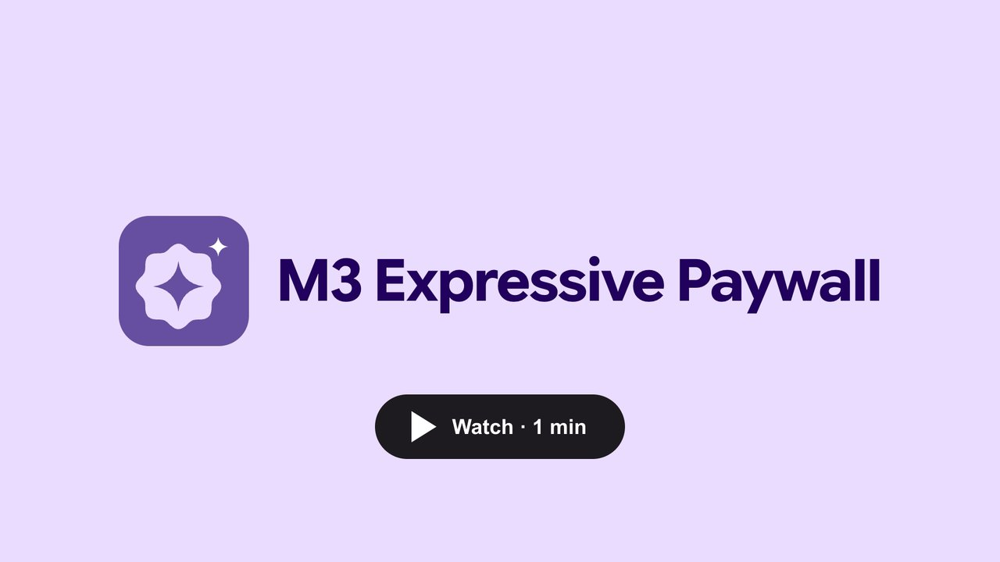</a><br />
  <sub>▶ <a href="https://paywall.sanikant.dev/#watch-the-1-minute-intro">Watch the 1-minute intro</a> (with captions) or <a href="art/intro.mp4">download the MP4</a>. Made in code with <a href="video/intro">HyperFrames</a>.</sub>
</p>

<p align="center">
  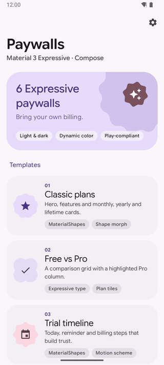
</p>

Copy-paste paywall screens built with the newest **Material 3 Expressive** APIs: `ButtonGroup`,
`ToggleButton`, `MaterialShapes` with shape morphing, `LinearWavyProgressIndicator`,
`MotionScheme.expressive()` springs and the emphasized type scale, set in **Google Sans Flex**
in the demo. Every screen works in light
and dark mode, follows your app's `MaterialTheme` (dynamic color included) and shows everything
Google Play asks for on a subscription screen.

**No billing SDK inside.** Each paywall takes a list of plans and three callbacks. Connect it to
Google Play Billing, RevenueCat, Adapty, Qonversion or your own backend.

## Try it

Download the demo APK from [Releases](https://github.com/sanikantv/m3-expressive-paywall/releases/latest)
and install it on any Android 8.0+ device. The demo uses fake prices and never charges anything.

## The 6 designs

| [1. Classic plans](https://paywall.sanikant.dev/components/classic-plans-paywall/) | [2. Free vs Pro](https://paywall.sanikant.dev/components/comparison-paywall/) | [3. Trial timeline](https://paywall.sanikant.dev/components/trial-timeline-paywall/) |
|:---:|:---:|:---:|
| 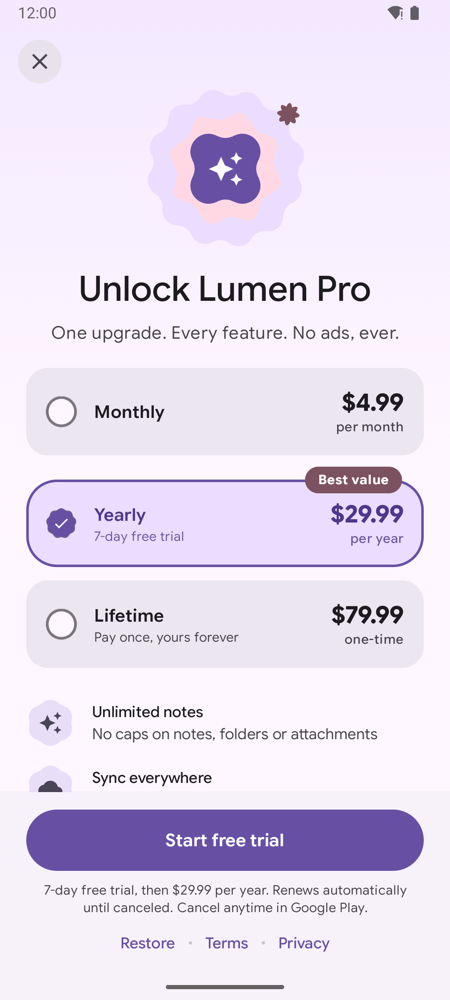 | 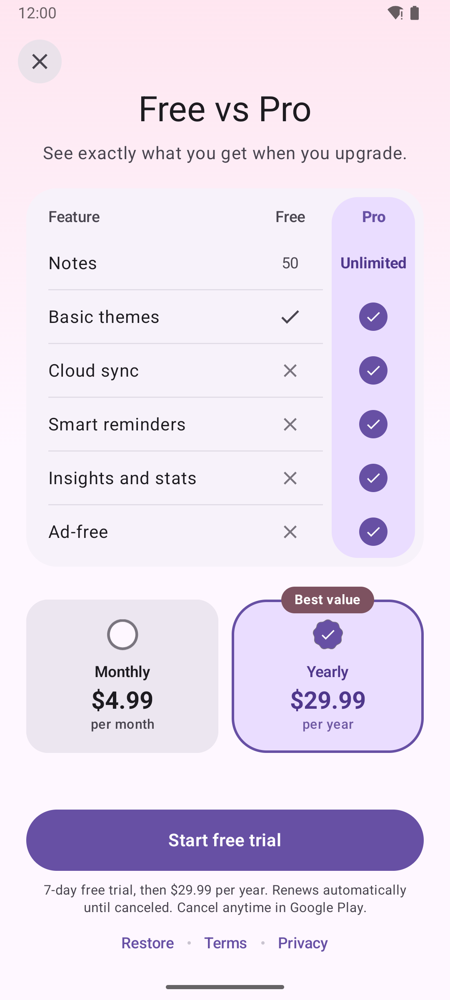 | 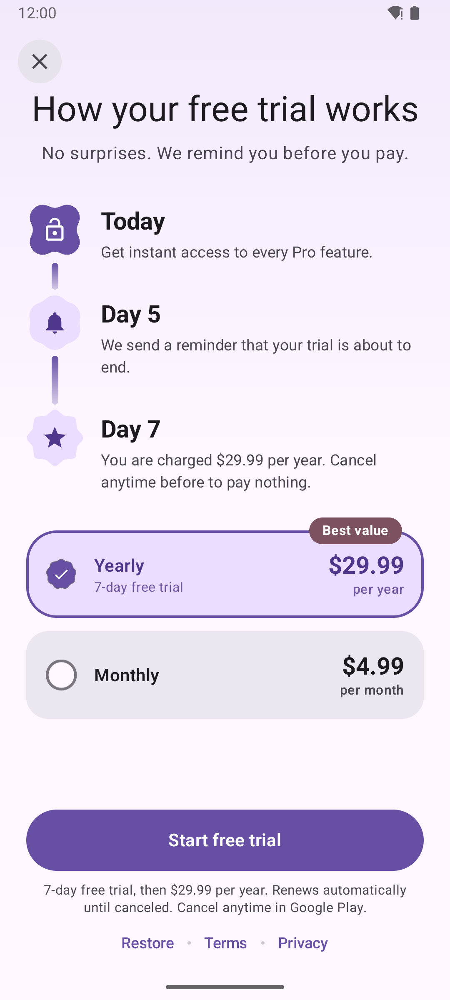 |
| Hero, plan cards with a morphing radio, a "Best value" badge and features. | Comparison grid with a highlighted Pro column and check and cross icons. | "Today, Day 5 reminder, Day 7 billing" steps that build trust. |

| [4. Plan picker](https://paywall.sanikant.dev/components/plan-picker-paywall/) | [5. Limited-time offer](https://paywall.sanikant.dev/components/limited-offer-sheet/) | [6. Onboarding end](https://paywall.sanikant.dev/components/onboarding-paywall/) |
|:---:|:---:|:---:|
| 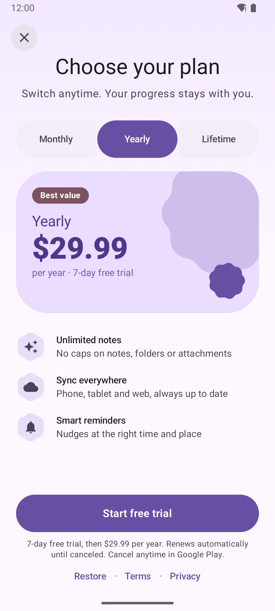 | 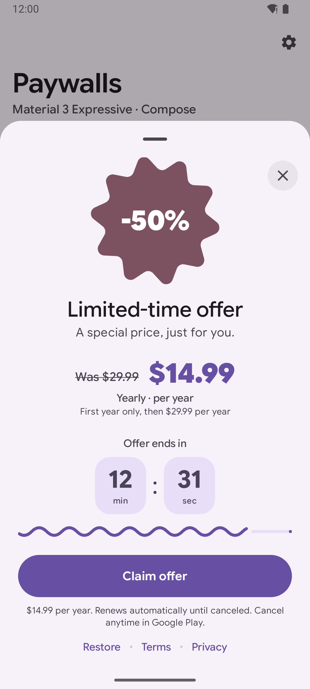 | 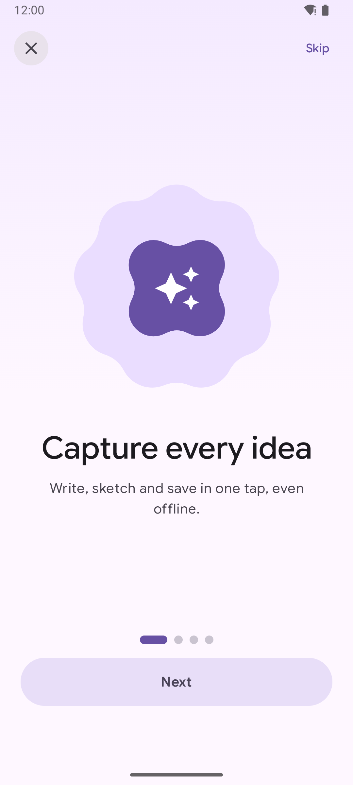 |
| Connected `ButtonGroup`; the spotlight card morphs and the price rolls. | Discount sheet with a live countdown and a wavy progress bar. | Benefits carousel that ends in the plan selection. |

<details>
<summary><b>Dark mode</b></summary>

| Classic | Free vs Pro | Trial | Plan picker | Offer | Onboarding |
|:---:|:---:|:---:|:---:|:---:|:---:|
| 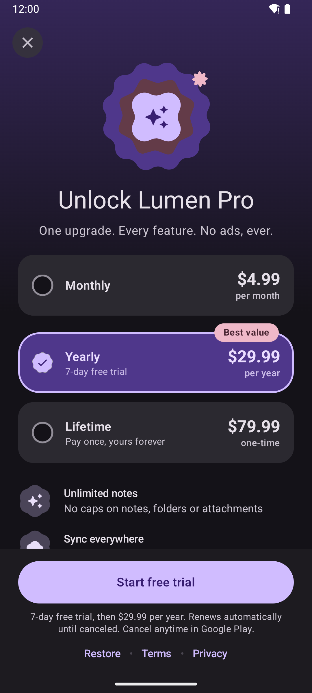 | 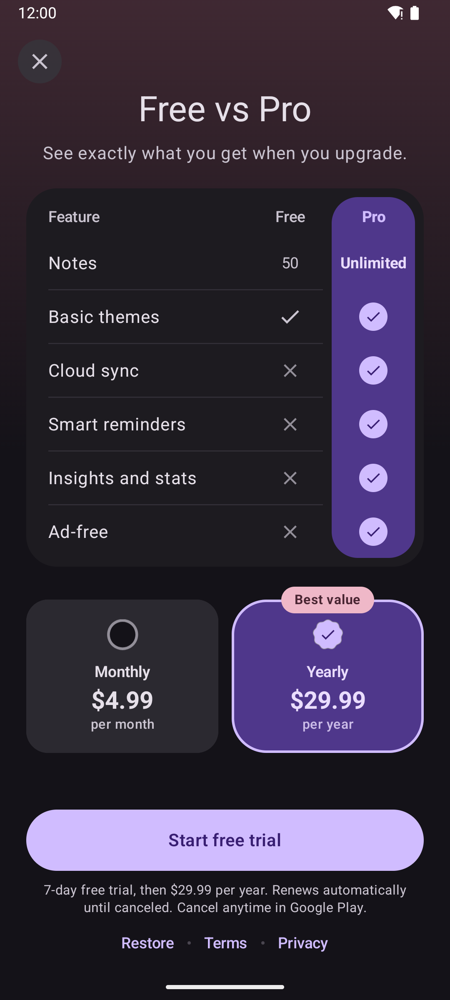 | 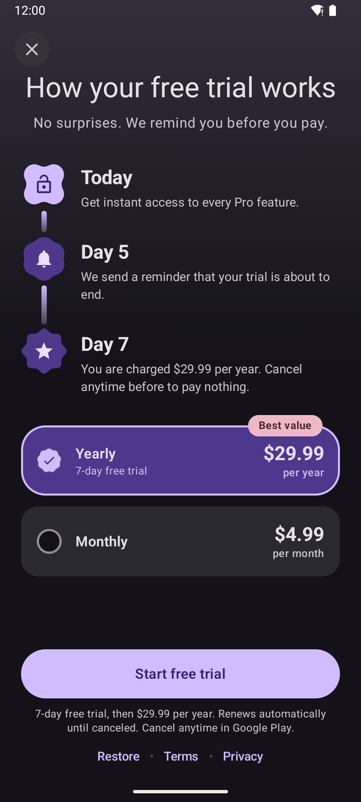 | 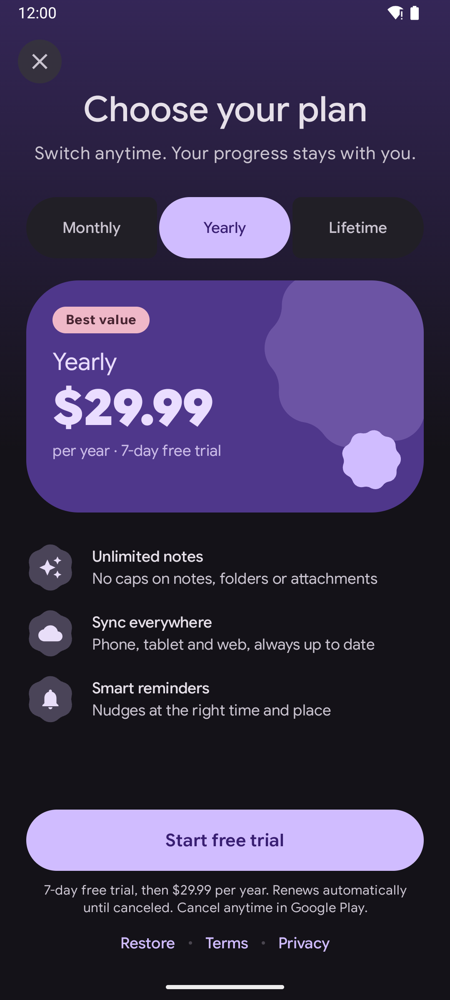 | 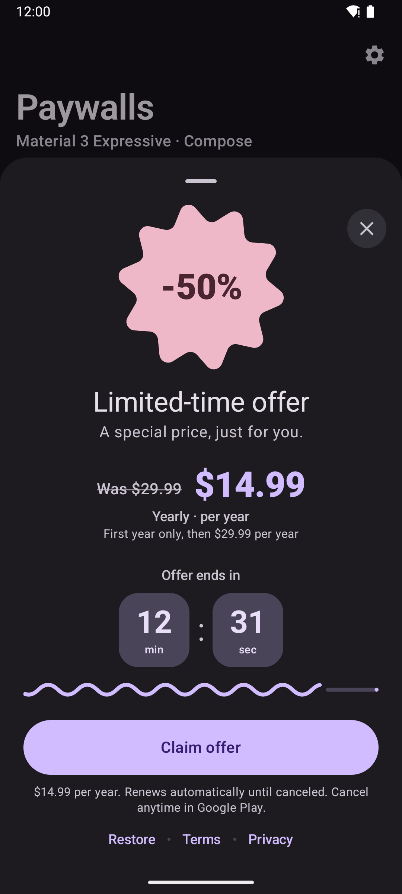 | 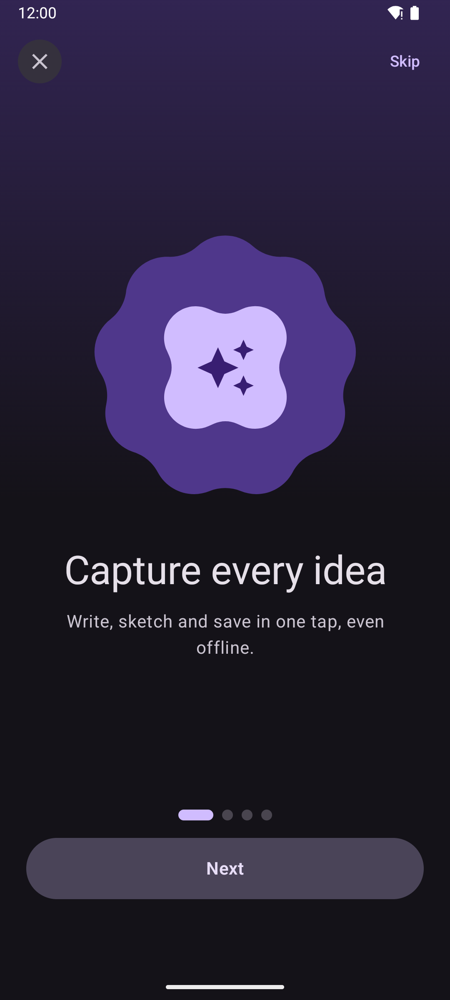 |

</details>

<details>
<summary><b>Demo gallery</b></summary>

| Light | Dark |
|:---:|:---:|
| 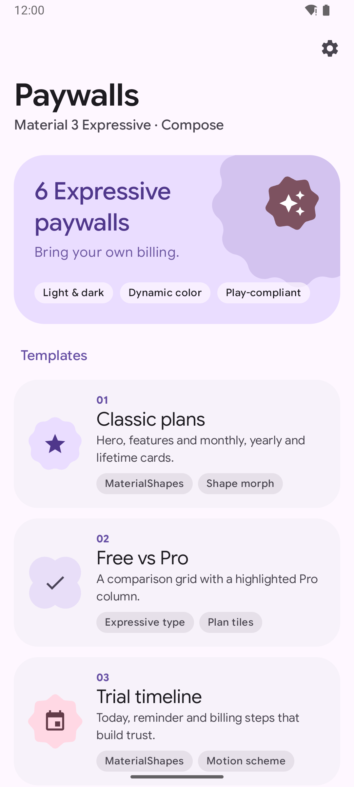 | 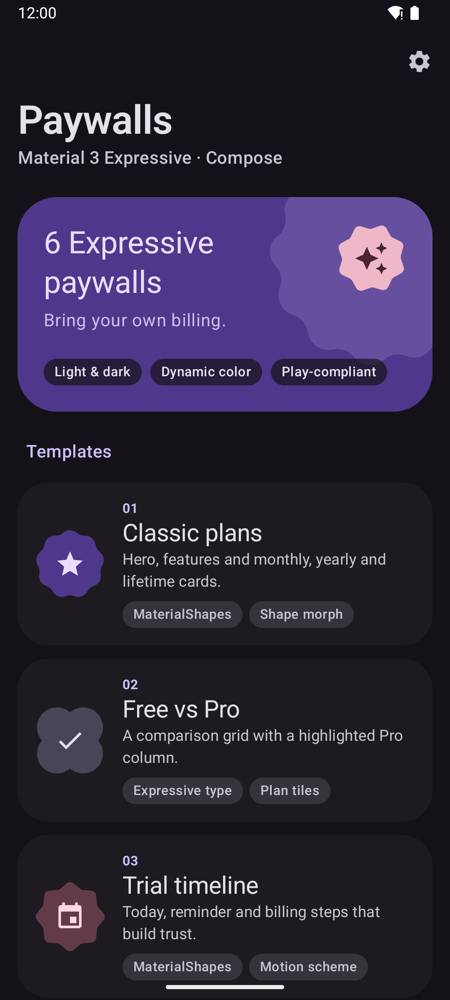 |

</details>

## Google Play compliance built in

The templates follow Google Play's subscription rules: the price, billing period, trial terms
and auto-renewal are shown next to the button for the selected plan. Many paywall samples skip
these items; here a shared footer puts them on every screen, so you can't forget one:

- [x] **Price** of the selected plan, from your store data
- [x] **Billing period** ("per month", "per year", "one-time")
- [x] **Trial terms**: "7-day free trial, then $29.99 per year"
- [x] **Auto-renew disclosure**: "Renews automatically until canceled. Cancel anytime in Google Play."
- [x] **Restore** button, plus **Terms** and **Privacy** links (good practice; Google's policy page
      doesn't name them, but users and other stores expect them)

One-time plans (`isSubscription = false`) get a "no subscription, no renewals" line instead.
Read Google's [subscription policy](https://support.google.com/googleplay/android-developer/answer/9900533)
before you ship, or the checklist in
[Google Play subscription paywall requirements](https://paywall.sanikant.dev/guides/google-play-subscription-paywall-requirements/).
You are responsible for the final copy and prices in your app.

## Setup

**1. Add JitPack** in `settings.gradle.kts`:

```kotlin
dependencyResolutionManagement {
    repositories {
        google()
        mavenCentral()
        maven("https://jitpack.io")
    }
}
```

**2. Add the dependency** in `gradle/libs.versions.toml`:

```toml
[versions]
m3Paywall = "v1.0.0"

[libraries]
m3-paywall = { module = "com.github.sanikantv:m3-expressive-paywall", version.ref = "m3Paywall" }
```

```kotlin
dependencies {
    implementation(libs.m3.paywall)
}
```

The library brings `androidx.compose.material3:material3:1.5.0-beta02` with it, which needs
`compileSdk = 37`.

**Prefer copy-paste?** Copy any file from
[`paywall/src/main/java/dev/sanikant/m3/paywall/`](paywall/src/main/java/dev/sanikant/m3/paywall/)
plus the `internal/` folder and `res/values/strings.xml` into your app.

## Usage

```kotlin
ClassicPlansPaywall(
    plans = listOf(
        PaywallPlan(id = "monthly", title = "Monthly", price = "$4.99", period = "per month"),
        PaywallPlan(
            id = "yearly", title = "Yearly", price = "$29.99", period = "per year",
            trialText = "7-day free trial", badge = "Best value",
        ),
        PaywallPlan(id = "lifetime", title = "Lifetime", price = "$79.99", period = "one-time", isSubscription = false),
    ),
    features = listOf(
        PaywallFeature("Unlimited notes", "No caps on anything", PaywallIcons.Sparkle),
        PaywallFeature("Zero ads", icon = PaywallIcons.Block),
    ),
    legal = PaywallLegal(termsUrl = "https://your.app/terms", privacyUrl = "https://your.app/privacy"),
    onPurchase = { plan -> billing.buy(plan.id) },
    onRestore = { billing.restore() },
    onClose = { navController.popBackStack() },
)
```

All six share the same contract:

| Composable | Extra inputs | Expressive APIs used |
|---|---|---|
| `ClassicPlansPaywall` | `features` | `MaterialShapes`, `Morph`, `MotionScheme` |
| `ComparisonPaywall` | `rows: List<ComparisonRow>` | Emphasized type, morphing plan tiles |
| `TrialTimelinePaywall` | `steps` (defaults from the trial plan) | `MaterialShapes` timeline nodes |
| `PlanPickerPaywall` | `features` | `ButtonGroupDefaults` + `ToggleButton`, `Morph` |
| `LimitedOfferSheet` | `plan`, `originalPrice`, `discountLabel`, `offerEndsAtMillis` | `LinearWavyProgressIndicator`, `ModalBottomSheet` |
| `OnboardingPaywall` | `pages: List<BenefitPage>` | `HorizontalPager`, emphasized type |

Every string has a default in `strings.xml` (prefixed `pw_`) and can be overridden through
parameters such as `title` and `subtitle`, so the paywalls are ready to translate.

### Fonts

The paywalls use `MaterialTheme.typography`, so they take your app's font. The demo uses
[Google Sans Flex](https://fonts.google.com/specimen/Google+Sans+Flex), a variable font, for the whole
Material 3 type scale including the Expressive emphasized styles:

```kotlin
val GoogleSansFlex = FontFamily(
    listOf(400, 500, 600, 700, 800, 900).map { weight ->
        Font(R.font.google_sans_flex, FontWeight(weight), variationSettings = FontVariation.Settings(FontVariation.weight(weight)))
    },
)

MaterialExpressiveTheme(typography = Typography(GoogleSansFlex)) { /* paywalls here */ }
```

See [Type.kt](app/src/main/java/dev/sanikant/m3/paywall/demo/ui/theme/Type.kt).

## Connect your billing

The library only needs formatted strings, so mapping is a few lines. Both examples are compiled
against the library in [`docs-snippets/`](docs-snippets/); the full step-by-step guides are on the
docs site.

<details>
<summary><b>Google Play Billing 9</b> · <a href="https://paywall.sanikant.dev/guides/connect-paywall-google-play-billing/">full guide</a></summary>

```kotlin
/** One PaywallPlan per base plan or offer. The offer token becomes the plan id. */
fun ProductDetails.toPaywallPlans(): List<PaywallPlan> =
    subscriptionOfferDetails.orEmpty().map { offer ->
        val phases = offer.pricingPhases.pricingPhaseList
        val recurring = phases.last()                            // the price after any trial or intro phase
        val freeTrial = phases.firstOrNull { it.priceAmountMicros == 0L }
        val yearly = recurring.billingPeriod == "P1Y"
        PaywallPlan(
            id = offer.offerToken,
            title = if (yearly) "Yearly" else "Monthly",
            price = recurring.formattedPrice,                    // already localized by Google Play
            period = if (yearly) "per year" else "per month",
            trialText = freeTrial?.let { "${isoPeriodToText(it.billingPeriod)} free trial" },
            badge = if (yearly) "Best value" else null,
        )
    }

/** "P7D" -> "7-day", "P1M" -> "1-month". Google Play uses ISO 8601 periods. */
fun isoPeriodToText(iso: String): String {
    val match = Regex("P(\\d+)([DWMY])").find(iso) ?: return iso
    val (amount, unit) = match.destructured
    val word = when (unit) { "D" -> "day"; "W" -> "week"; "M" -> "month"; else -> "year" }
    return "$amount-$word"
}

fun launchPurchase(
    activity: Activity,
    billingClient: BillingClient,
    product: ProductDetails,
    plan: PaywallPlan,
): BillingResult {
    val productParams = BillingFlowParams.ProductDetailsParams.newBuilder()
        .setProductDetails(product)
        .setOfferToken(plan.id)
        .build()
    val flowParams = BillingFlowParams.newBuilder()
        .setProductDetailsParamsList(listOf(productParams))
        .build()
    return billingClient.launchBillingFlow(activity, flowParams)
}
```

</details>

<details>
<summary><b>RevenueCat 10</b> · <a href="https://paywall.sanikant.dev/guides/connect-paywall-revenuecat/">full guide</a></summary>

```kotlin
fun Package.toPaywallPlan(): PaywallPlan = PaywallPlan(
    id = identifier,
    title = when (packageType) {
        PackageType.ANNUAL -> "Yearly"
        PackageType.MONTHLY -> "Monthly"
        PackageType.LIFETIME -> "Lifetime"
        else -> product.title
    },
    price = product.price.formatted,
    period = product.period?.let { "per ${it.unit.name.lowercase()}" } ?: "one-time",
    trialText = product.defaultOption?.freePhase?.billingPeriod?.let { "${it.value}-${it.unit.word()} free trial" },
    badge = if (packageType == PackageType.ANNUAL) "Best value" else null,
    isSubscription = product.period != null,
)

private fun Period.Unit.word(): String = name.lowercase()

fun purchase(activity: Activity, packages: List<Package>, plan: PaywallPlan, onUnlocked: () -> Unit) {
    val pkg = packages.first { it.identifier == plan.id }
    Purchases.sharedInstance.purchaseWith(
        PurchaseParams.Builder(activity, pkg).build(),
        onError = { error, userCancelled -> if (!userCancelled) println(error.message) },
        onSuccess = { _, customerInfo ->
            if (customerInfo.entitlements["pro"]?.isActive == true) onUnlocked()
        },
    )
}

fun restore(onUnlocked: () -> Unit) {
    Purchases.sharedInstance.restorePurchasesWith(
        onError = { error -> println(error.message) },
        onSuccess = { customerInfo ->
            if (customerInfo.entitlements["pro"]?.isActive == true) onUnlocked()
        },
    )
}
```

</details>

Real prices must always come from the store. Never hard-code them.

## For AI coding agents

This repo is written to be easy for Claude Code, Cursor, Codex and Copilot to learn from:

- [`llms.txt`](llms.txt): a short map of the project.
- [`docs/PAYWALL_CATALOG.md`](docs/PAYWALL_CATALOG.md): when to use each design, the exact
  signature, the Expressive APIs it uses, and ready-to-paste prompts.

Example prompt: *"Add the trial timeline paywall from github.com/sanikantv/m3-expressive-paywall
to my app and connect `onPurchase` to my existing BillingRepository."*

## Tech stack and versions

| | Version |
|---|---|
| `androidx.compose.material3` | **1.5.0-beta02** (pinned) |
| Compose BOM | 2026.09.00 |
| Kotlin | 2.2.10 |
| Android Gradle Plugin | 9.4.1 (Gradle 9.8.2) |
| compileSdk / targetSdk / minSdk | 37 / 36 / 26 |
| `androidx.graphics:graphics-shapes` | 1.1.0 |
| Demo font | Google Sans Flex (variable, SIL OFL 1.1) |

Material 3 Expressive APIs are marked `@ExperimentalMaterial3ExpressiveApi` and can still change
before `1.5.0` stable. If something does not compile, check your material3 version first.

## Project layout

```
paywall/   the library (published on JitPack): 6 public composables + internal/ shared parts
app/       the demo: gallery, settings sheet (theme, dynamic color, motion), fake data
art/       icon, screenshots, hero GIF, social preview
scripts/   capture.sh (screenshots), record_hero.sh (GIF), make_icon.py + render_icon.sh
docs/      PAYWALL_CATALOG.md for humans and AI agents
video/intro/    the intro video as code (HyperFrames scenes, voiceover, captions), see video/intro/README.md
docs-snippets/  every code sample on the docs site, compiled on each build (not published)
site/      the docs site (Astro + Starlight) deployed to paywall.sanikant.dev, see site/DEPLOY.md
```

Rebuild the screenshots with `ANDROID_SERIAL=emulator-5554 ./scripts/capture.sh`.

## Related

- [Guides on paywall.sanikant.dev](https://paywall.sanikant.dev/guides/): Google Play subscription
  rules, Play Billing, RevenueCat, countdowns, shape morphing and connected button groups in Compose.
- More Material 3 Expressive screens and components are on the way. Follow
  [@sanikantv on GitHub](https://github.com/sanikantv) to see them first.

## Built by

**Sanikant**, Android developer shipping apps on Google Play and the App Store.

- YouTube: [@Sanikant_Kushwaha](https://www.youtube.com/@Sanikant_Kushwaha)
- Website: [sanikantkushwaha.com](https://sanikantkushwaha.com/)

Design patterns were researched on Mobbin. No screenshots or assets from other apps are included.
Icons are Material icons (Apache 2.0). The demo bundles the unmodified Google Sans Flex font from
[google/fonts](https://github.com/google/fonts/tree/main/ofl/googlesansflex) under the
[SIL Open Font License 1.1](licenses/GoogleSansFlex-OFL.txt). "Google Sans Flex" is a trademark of
Google LLC; this project is not affiliated with or endorsed by Google.

## License

Code: [MIT](LICENSE) © 2026 Sanikant. Font: [SIL OFL 1.1](licenses/GoogleSansFlex-OFL.txt).
